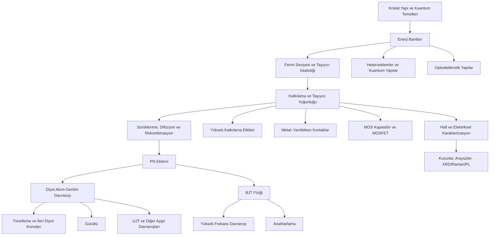

# Yarıiletken Fiziği — İnteraktif Ders Çalışma Yardımcısı

Bu çalışma, yarıiletken fiziğini yalnızca formülleri ezberleyerek değil; **fiziksel sezgi, bant diyagramları, taşıyıcı istatistiği, interaktif grafikler ve problem çözme** üzerinden öğrenmeye yardımcı olmak için hazırlanmış **14 haftalık çekirdek ders + 6 modern yarıiletken yapılar modülünden** oluşan bir ders çalışma dokümanıdır.

> **Amaç:** Bir denklemi kullanabilmenin yanında, o denklemin ne anlattığını, hangi büyüklüklerin sonucu nasıl değiştirdiğini ve farklı yarıiletken aygıtlarının aynı temel fizik üzerinden nasıl birbirine bağlandığını görebilmek.


## 1. Hafta: atomlar arası uzaklık, DOS ve taşıyıcı istatistiği

**Görseller** sekmesinin başına üç bağlantılı, etkileşimli eğitim aracı eklendi. Türkçe/İngilizce anlatımda 1.2 Enerji Bantları başlığı altında konuların ön koşulları ve formüllerin fiziksel yorumları açıklanır.

1. **Bant oluşumu ve denge uzaklığı:** Si, Ge, GaAs, GaN ve 4H-SiC için en yakın komşu atom uzaklıkları ile 300 K bant aralığı karşılaştırılır. Soldaki elektronik bant genişliği için **üstel örtüşmeye dayalı şematik bir model**, sağdaki normalize bağ potansiyeli için **Morse eğrisi** kullanılır. Bu grafikler *ab initio* hesap, gerçek atomik 3s/3p spektrumu veya basınç altındaki malzeme bant yapısı tahmini değildir. Bağ enerjisi grafiği ile elektron bant enerjisi grafiği farklı fiziksel büyüklükleri gösterir.
2. **Durum yoğunluğu:** İdeal üç boyutlu parabolik bant yaklaşımında \(g(E)\propto (m^*)^{3/2}\sqrt{|E-E_{\rm edge}|}\). DOS ekseni 10²¹ durum / (cm³·eV) cinsindedir. Etkin DOS kütleleri yaklaşık değerlerdir; spin ve ilgili vadi çokluğu etkin kütleye dahildir. Seçili enerji dilimindeki durum sayısı \(\int_{E_1}^{E_2}g_c(E)\,dE\) ile hesaplanır. Yasak aralıkta ideal hacimsel DOS sıfırdır (kusurlar ve kuyruk durumları dahil değildir).
3. **Fermi–Dirac / Boltzmann:** 0, 100, 300, 600 K ve kullanıcı sıcaklığında \(f(E,T)\) karşılaştırılır. Boltzmann elektron kuyruğu \(f_B=\exp[-(E-E_F)/(k_BT)]\) sadece \(E\ge E_F\) tarafında çizilir. **Bağıl hata** \( (f_B-f_{\rm FD})/f_{\rm FD} = \exp[-(E-E_F)/(k_BT)] \); bu yüzden \(E-E_F\ge3k_BT\) sınırında hata en çok %4,98 olur. Olasılık ile DOS karıştırılmamalıdır: \(n=\int g_c(E)f(E,T)\,dE\).

Bu simülasyonlar sitenin mevcut Plotly bağımlılığını kullanır, ayrıca paket veya yeni CDN eklemez. Denge uzaklıkları *en yakın komşu bağ uzunluklarıdır*; kübik örgü sabiti değildir.


## Yeni içerik organizasyonu: iki ana bölüm

Başlangıç ekranında yalnızca **I. Yarıiletken Fiziği** ve **II. Yarıiletken Cihazları** kartları bulunur. Kart seçildiğinde sol menüde **Geri · Ana bölümler** düğmesi, seçilen bölümün başlığı ve yalnızca o bölümdeki konular listelenir. Var olan 20 ders/modülün içeriği ve hafta kimlikleri korunmuştur.

### I. Yarıiletken Fiziği

Ders **1** (temel fizik), **5** (yüksek katkılama etkileri), **19** (Hall etkisi ve elektriksel karakterizasyon) ve **20** (kusurlar, arayüzler ve malzeme karakterizasyonu). Ders 1'e ait **on konu, sayfa içindeki büyük kutular yerine sol menüye taşınmıştır**. Konu seçimi Anlatım sekmesini açıp doğrudan ilgili açıklamaya kaydırır. Türkçe/İngilizce başlangıç düzeyi açıklamalar ve bilimsel grafikler korunmuştur:

1. Kristal yapı ve atomlar
2. Kristal içindeki elektron (Bloch dalgaları, E(k))
3. Enerji band teorisi
4. Değerlik ve iletim bantları
5. Bantlarda durum yoğunluğu (DOS)
6. Hol kavramı
7. Fermi seviyesi ve doluluk olasılığı
8. Elektron–hol dengesi ve kütle etkisi yasası
9. Has ve katkılı yarıiletkenler
10. Sürüklenme, difüzyon ve cihaz fiziğine geçiş

**Öğrenme sırası:** izin verilen kuantum durumları → bu durumların sayısı → doluluk olasılığı → elektron/hol yoğunlukları → denge → yük taşınımı. Ders 1'in mevcut matematiksel temel, özgün simülasyonlar, görseller ve soru-cevap içerikleri değişmeden kalır.


### Arayüz regresyon kontrolü

Geçişler, 10 fizik konusu, ileri fizik dersleri ve 16 cihaz dersi için bağımsız Node testi:

```bash
node tests/course-navigation.test.js
```

Bu test gezinme modelini ve sayfa kodu bağlantılarını denetler; gerçek tarayıcıdaki görsel görünümü tek başına doğrulamaz.

### II. Yarıiletken Cihazları

Ders **2–4, 6–18**: p-n eklem diyotları, tünel diyot, büyük/küçük sinyal, fazla akım, gürültü, BJT ve yüksek frekans/güç/anahtarlama cihazları, UJT; ayrıca metal–yarıiletken temaslar, MOS/MOSFET, heteroeklemler, kuantum yapılar ve optoelektronik cihazlar.

**Teknik not:** İki üst bölüm menü organizasyonudur; ders şablonları taşınmadığı veya silinmediği için önceki derslerin içerikleri ve görsel kontroller çalışmaya devam eder. Uygulama her yüklemede iki kartlı giriş ekranından başlar; bölüm seçimi sonrası mobilde geri düğmesi ve başlık üstte, konu bağlantıları yatay kaydırılabilir şeritte görünür. Kayıtlı hafta numarası silinmez, ancak otomatik olarak içeriğe girilmez. Dil değiştirme açık bölümde kalır; Geri düğmesi iki kartlı giriş ekranına döner.


## Bölüm I için ileri anlatım: Bloch, atomik seviyeler ve durum yoğunluğu

**Yarıiletken Fiziği → Ders 1** altında Türkçe ve İngilizce açıklamalar genişletildi. **Anlatım** sekmesindeki ilgili üç kavram kutusu formüller, fiziksel sezgi ve kontrol sorularını içerir. **Görseller** sekmesinin başına üç etkileşimli laboratuvar ve Bloch laboratuvarı içinde ayrıca Bragg bant ayrışması eklenmiştir.

### 1. Periyodik örgüde elektron: Bloch teoremi

Bir boyutlu periyodik potansiyelde \(V(x+a)=V(x)\) için Bloch durumu

\[
\psi_k(x)=e^{ikx}u_k(x),\qquad u_k(x+a)=u_k(x)
\]

biçimindedir. \(\psi_k(x+a)=e^{ika}\psi_k(x)\): komşu hücrede dalganın **fazı** değişir; olasılık yoğunluğu periyodiktir. İnteraktif grafikte \(\psi_k(x)=\sum_n e^{ikna}\phi(x-na)\) şeklinde Gauss-benzeri yerel orbital toplamı kullanılır (çizim bölgesinin dışında da atomlar alınır). Bu bir **nitel, tek boyutlu Bloch örneğidir**; silisyumun gerçek dalga fonksiyonu veya Schrödinger denkleminin sayısal özdeğer çözümü değildir.

Bragg alt grafiğinde neredeyse serbest elektron yaklaşımının yalnızca **iki düzlem dalga bileşeni** birlikte kullanılır:

\[
H(k)=\begin{pmatrix}\alpha k^2 & V_G \\ V_G & \alpha(k-G)^2\end{pmatrix},\quad G=\frac{2\pi}{a}.
\]

Bölge sınırı \(k=G/2\) için enerji ayrışması \(\Delta=2|V_G|\) olur. \(V_G=0\) iken seviyeler kesişir, \(V_G>0\) iken ayrışır. Bu, periyodik potansiyelin bant boşluğu **açabilmesinin** basit bir mekanizmasıdır; gerçek Si/Ge bant aralıklarının hesabı değildir.

### 2. Atomik seviyelerin bantlara dönüşümü

Açık uçlu, \(N\) atomlu bir boyutlu, yakın-komşu *tight-binding* zincirde tek etkin orbitalin seviyeleri:

\[
E_j=\varepsilon_0-2t\cos\left(\frac{j\pi}{N+1}\right),\quad j=1,\ldots,N.
\]

Modelde iki **bağımsız etkin orbital ailesi** alınır (bağlayıcı/değerlik ve karşıt-bağlayıcı/iletim). Her aile için \(N\) seviye vardır; spin iki katlı degenerelik olarak ayrıca değerlendirilir. Seçilen Si, Ge ve GaAs için 300 K referans \(E_g\) değerleri, **sonsuz zincir ve seçili denge mesafesi limitinde** model parametresine eşlenmiştir.

Etkileşim \(t(r)=t_0 e^{-2.8(r/r_0-1)}\), \(t_0=0.72\) eV şeklinde **gösterim amacıyla** seçilmiştir. \(N\to\infty\) durumunda her bandın genişliği yaklaşık \(4t\) olur. \(N\) artarken seviyeler sıklaşır; bant genişliği sınırsız büyümez. Bu model gerçek sp³ orbitalleri, çoklu vadiler, elektron-elektron etkileşimi, deneysel bağ enerjisi veya basınç altında \(E_g(r)\) tahmini değildir.

### 3. \(E(k)\) geometrisinden 1B, 2B, 3B DOS'a

İzotropik bir parabolik bant kenarında

\[
E-E_c=\frac{\hbar^2 k^2}{2m^*},\qquad
\mathcal N_d(E)\propto(E-E_c)^{d/2}.
\]

Dolayısıyla \(g_d(E)=d\mathcal N_d/dE\propto(E-E_c)^{d/2-1}\). **1B:** ters karekök tekilliği; **2B:** sabit DOS; **3B:** karekök artışı. 1B, 2B, 3B k-uzayında **farklı sayma geometrileridir**; DOS, tek bir \(E(k)\) kesitinden doğrudan okunamaz.

Grafiklerin şekli \(E-E_c=0.20\) eV değerinde normalize edilir. Sayısal DOS ölçümü, spin iki katlı ve tek izotropik vadi için boyuta özgü \(\mathrm{cm}^{-d}\,\mathrm{eV}^{-1}\) birimleriyle verilir. Birim dönüşümü için \(\hbar^2/(2m_0)=0.03809982\ \mathrm{eV\,nm^2}\) kullanılmıştır. Gerçek Si gibi anizotropik, çok vadili kristaller bu modelin kapsamı dışındadır. **DOS, doluluk olasılığı değildir:** taşıyıcı yoğunluğu için \(n=\int g_c(E)f(E,T)dE\) ayrıca hesaplanmalıdır.

### Sayısal doğrulama

Yeni grafik kodunun dış bağımlılıksız sayısal regresyon testi:

```bash
node tests/solid-state-foundations.test.js
```

Testler Bloch çeviri/faz koşulunu, Bragg sınırındaki enerji ayrışmasını, atom sayısına bağlı bant yakınsamasını, seçilen üç malzemenin denge aralığı kalibrasyonunu, 1B–3B DOS enerji/etkin kütle üslerini ve ana sayfa entegrasyonunu kontrol eder. Gerçek tarayıcı arayüzünün görsel regresyonu ayrı doğrulama gerektirir.

## On ayrı fizik dersi ve dört sekme

**I. Yarıiletken Fiziği → Temel Konular** altındaki 10 başlık artık tek sayfadaki kaydırma hedefleri değil, **birbirinden ayrı ders sayfalarıdır**. Her derste dört sekme bulunur: **Anlatım**, **Matematiksel Temel**, **Görsel / Simülasyon**, **Soru–Cevap**. Konu başlığı ve içerik seçime göre değişir; sol menüde aktif konu işaretlenir.

| No | Konu | Ana simülasyon |
|---|---|---|
| 01 | Kristal yapı ve atomlar | Elmas / zincblende örgüleri, atomlar arası mesafe |
| 02 | Kristal içindeki elektron | Bloch dalgaları ve Bragg ayrışması |
| 03 | Enerji band teorisi | Tight-binding, atomik seviyelerin bantlara dönüşmesi |
| 04 | Değerlik ve iletim bandı | E(k), doğrudan/dolaylı aralık, bant enerjileri |
| 05 | Durum yoğunluğu | 1B/2B/3B DOS ve seçili enerji aralığı |
| 06 | Hol kavramı | Elektron atlaması ve holün ters yönde hareketi |
| 07 | Fermi seviyesi | Fermi–Dirac, sıcaklık ve Boltzmann |
| 08 | Elektron–hol dengesi | Has taşıyıcı yoğunluğu ve termal denge |
| 09 | Has ve katkılı yarıiletkenler | Donör/akseptör, freeze-out, taşıyıcı yoğunlukları |
| 10 | Taşıyıcı hareketi ve geçiş | Sürüklenme, difüzyon, saçılma ve rekombinasyon |

### İçerik koruma ve teknik yaklaşım

Yeni **assets/physics-topic-pages.js**, mevcut 1. hafta şablonundaki DOM elemanlarını **kopyalamadan** ilgili konu ve sekmeye taşır. Böylece eski grafik ID'leri ve slider olayları korunur. Yeni **assets/physics-topic-pages.css** yalnızca seçilen ders ve seçilen sekmenin gösterilmesini sağlar. Eski 20 ders/modülün geri kalanı, tema ve iki dil seçeneği korunur.

Matematiksel temel sekmelerinde her başlığa özgü formül özeti bulunur, mevcut ayrıntılı türetimler ilgili konulara ayrılır. Mevcut 22 soru korunmuştur; 10 yeni kavramsal soruyla **32 soru** sunulur. Hol konusundaki yeni yedi durumlu boşluk hareketi görseli şematik bir doluluk modelidir, gerçek zamanlı kuantum dinamiği değildir.

Regresyon testleri:

```bash
node tests/physics-topic-pages.test.js
node tests/solid-state-foundations.test.js
```

İlk test Türkçe ve İngilizce 10 dersin 40 sekmesini, 19 görsel bölümünü, 32 soru-cevabı, boş olmayan sekmeleri ve görünürlük geçişlerini bağımlılıksız DOM taklidi ile doğrular. **Gerçek tarayıcı görsel regresyonu ve CI sonucu ayrıca doğrulanmalıdır.**

## Nasıl çalışılmalı?

Her konuyu mümkünse şu sırayla çalışın:

1. **Önce fiziksel fikri okuyun.** Formüle geçmeden önce olayın ne olduğunu kendi cümlelerinizle açıklamaya çalışın.
2. **Denklemi inceleyin.** Her sembolün fiziksel anlamını ve birimini kontrol edin.
3. **Grafiğe bakmadan tahmin yapın.** Bir parametre artarsa eğrinin veya bant diyagramının nasıl değişeceğini düşünün.
4. **İnteraktif kontrollerle deneyin.** Tahmininizle simülasyon sonucunu karşılaştırın.
5. **Kavramsal soruları çözün.** Sonucu değil, nedenini açıklayabiliyor olmayı hedefleyin.
6. **Hafta sonunda geri çağırın.** Notlara bakmadan ana kavramları ve temel denklemleri yazmayı deneyin.

## Kavram Haritası



Bu haritanın önemli mesajı şudur: konular birbirinden bağımsız değildir. Özellikle **enerji bantları → Fermi seviyesi → taşıyıcı yoğunluğu → PN eklemi → diyot/BJT** zinciri dersin omurgasını oluşturur.

## Çekirdek 14 Haftalık Çalışma Rotası

| Aşama | Odak | Çalışırken kendine sor |
|---|---|---|
| 1 | Kristal ve yarıiletken temelleri | Bir katıyı iletken, yalıtkan veya yarıiletken yapan nedir? |
| 2 | Bant teorisi | Yasak enerji aralığı fiziksel olarak neyi ifade eder? |
| 3 | Taşıyıcı istatistiği | Fermi seviyesi elektron ve delik yoğunluğunu nasıl belirler? |
| 4 | Katkılama ve taşınım | Katkılama, hareketlilik ve iletkenlik arasında nasıl bir ilişki vardır? |
| 5 | PN eklemi | Tükenim bölgesi neden kendiliğinden oluşur? |
| 6 | Diyot | İleri ve ters kutuplamada bantlar ve akım nasıl değişir? |
| 7 | İleri diyot konuları | İdeal model hangi durumlarda yetersiz kalır? |
| 8 | Gürültü | Termal, shot ve 1/f gürültülerinin fiziksel kökenleri nasıl ayrılır? |
| 9 | BJT temelleri | Küçük bir baz akımı büyük kolektör akımını neden kontrol edebilir? |
| 10 | BJT fiziksel modeli | Enjeksiyon, rekombinasyon ve taşıma kazancı nasıl belirler? |
| 11 | Yüksek frekans | Frekans arttığında ideal transistor modeli neden bozulur? |
| 12 | Anahtarlama | Depolanan yük anahtarlama süresini nasıl etkiler? |
| 13 | İleri/özel aygıt davranışları | Klasik yaklaşımın dışına çıkıldığında hangi fizik önem kazanır? |
| 14 | UJT ve genel tekrar | Farklı aygıtları ortak yarıiletken fiziği üzerinden açıklayabilir miyim? |

> Haftaların başlıkları uygulamadaki ayrıntılı içerikle birlikte kullanılmalıdır. Bu tablo bir **çalışma rotasıdır**, ders içeriğinin yerine geçmez.

## Modern Yarıiletken Yapılar Modülleri

Çekirdek 14 haftalık içerik korunmuştur. Bunun yanına, yüksek lisans düzeyinde yarıiletken **yapılar** fiziğini tamamlamak için aşağıdaki altı modül eklenmiştir:

| Modül | Konu | Ana bağlantı |
|---|---|---|
| 15 | Metal–yarıiletken kontaklar | İş fonksiyonu, elektron ilgisi, Schottky bariyeri, termiyonik emisyon, ohmik kontak |
| 16 | MOS kapasitör ve MOSFET fiziği | Accumulation, depletion, inversion, flat-band, C–V, threshold, kanal oluşumu |
| 17 | Heteroeklemler ve kuantum yapıları | Band offset, Type-I/II/III, quantum well, boyuta bağlı DOS, HBT/HEMT |
| 18 | Optoelektronik yarıiletken yapılar | Soğurma, direkt/dolaylı gap, fotodiyot, güneş hücresi, LED/lazer |
| 19 | Hall etkisi ve elektriksel karakterizasyon | Taşıyıcı tipi/yoğunluğu, mobilite, four-point probe, I–V ve C–V |
| 20 | Kusurlar, arayüzler ve malzeme karakterizasyonu | SRH tuzakları, yüzey durumları, XRD, Raman, PL, UV–Vis |

Ayrıca 1. haftada **Bloch teoremi, Brillouin bölgesi ve Kronig–Penney modeli** ile “kristal yapıdan enerji bantlarına nasıl geçiyoruz?” sorusu daha açık biçimde bağlanmıştır.

Bu genişletilmiş rota özellikle şu zinciri görünür kılmayı amaçlar:

```text
Kristal → periyodik potansiyel → E(k) → DOS/Fermi
        → taşıyıcılar ve transport
        → PN / Metal-SC / MOS / heteroeklem
        → optik, kuantum ve gerçek arayüz etkileri
        → deneysel karakterizasyon
```


## Her Hafta İçin Öğrenme Hedefi

Bir haftayı tamamlamış sayılmadan önce aşağıdaki dört seviyeyi kontrol edin:

- **Tanımla:** Temel kavramları ve sembolleri açıklayabiliyorum.
- **Tahmin et:** Bir parametre değiştiğinde sonucun hangi yönde değişeceğini grafiğe bakmadan söyleyebiliyorum.
- **Hesapla:** Temel denklemleri doğru birimlerle kullanabiliyorum.
- **Açıkla:** Çıkan sonucun fiziksel nedenini kendi cümlelerimle anlatabiliyorum.

Sadece hesap yapabiliyor olmak konunun tam öğrenildiği anlamına gelmez. Özellikle interaktif grafiklerde önce **tahmin**, sonra **deney**, ardından **açıklama** sırasını kullanın.

## Mini Deney Yöntemi

Bir slider veya parametreyi değiştirmeden önce küçük bir hipotez kurun:

> **Tahmin → Değiştir → Gözlemle → Açıkla**

Örnek:

**Soru:** PN ekleminde katkılama yoğunluğu artarsa tükenim bölgesinin genişliği ne olur?

Önce cevabınızı düşünün. Ardından parametreyi değiştirip grafiği gözlemleyin. Son olarak sonucu yalnızca “azaldı/arttı” diye değil, yük dengesi ve elektrik alan açısından açıklamaya çalışın.

Aynı yöntemi Fermi seviyesi, taşıyıcı yoğunluğu, diyot akımı, BJT kazancı, gürültü ve yüksek frekans davranışında da kullanabilirsiniz.

## Sık Yapılan Hatalar

### Formülü fiziksel modelden koparmak
Bir denklemi ezberlemek yerine hangi varsayımlar altında kullanıldığını düşünün. İnteraktif grafikler özellikle bu sezgiyi geliştirmek için kullanılmalıdır.

### Elektron ve delik işaretlerini karıştırmak
Elektronun yükünün negatif olması ile elektron yoğunluğunun pozitif bir sayı olması farklı kavramlardır.

### Fermi seviyesini “elektronların bulunduğu enerji” olarak düşünmek
Fermi seviyesi tek tek elektronların enerjisini göstermez; taşıyıcıların enerji durumlarını doldurma olasılığını belirleyen istatistiksel bir büyüklüktür.

### Enerji bantlarını gerçek uzaysal katmanlar gibi düşünmek
Bant diyagramları enerji ilişkilerini gösterir. Özellikle konuma bağlı bant diyagramlarında yatay eksenin neyi temsil ettiğini kontrol edin.

### Birimleri karıştırmak
Yarıiletken fiziğinde özellikle `cm⁻³` / `m⁻³`, `cm²/(V·s)` / `m²/(V·s)`, eV / J dönüşümlerine dikkat edin.

### Denge ile kutuplama durumunu karıştırmak
Termal dengede tek bir Fermi seviyesi kavramı kullanılır. Kutuplama ve denge dışı durumlarda yorum değişebilir.

### Grafiği yalnızca şekil olarak okumak
Eksenleri, ölçeğin lineer/logaritmik oluşunu ve değiştirilen parametreyi kontrol etmeden grafik hakkında sonuç çıkarmayın.

## Grafik Okuma Kontrolü

Bir grafiği incelerken şu dört soruya cevap verin:

1. **Eksenler neyi gösteriyor ve birimleri ne?**
2. **Hangi parametre sabit, hangisi değişiyor?**
3. **Limit durumlarında ne bekliyorum?**
4. **Grafikteki şekli hangi fiziksel mekanizma oluşturuyor?**

Özellikle logaritmik grafiklerde görsel eğimin lineer grafiklerle aynı şekilde yorumlanamayacağını unutmayın.

## Formül Çalışma Kartı

Yeni bir denklem gördüğünüzde aşağıdaki küçük kartı zihninizde doldurun:

| Soru | Kontrol |
|---|---|
| Ne hesaplıyor? | Çıktının fiziksel anlamı |
| Neye bağlı? | Bağımsız değişkenler |
| Birimi ne? | Boyut kontrolü |
| Hangi yönde değişir? | Fiziksel sezgi |
| Hangi koşullarda geçerli? | Modelin varsayımları |
| Grafikte nasıl görünür? | Denklem ↔ görsel bağlantısı |

## Kendini Test Et

Bir konuyu tamamladıktan sonra notlara bakmadan:

- Konuyu 60 saniyede sözlü olarak açıklayın.
- En önemli 3 kavramı yazın.
- Bir temel denklemi yazıp sembollerini açıklayın.
- Bir parametreyi 10 kat artırdığınızda ne olacağını tahmin edin.
- İlgili grafiği kabaca çizin.
- Konuyu bir önceki ve bir sonraki haftayla ilişkilendirin.

Bunlardan birini yapamıyorsanız doğrudan formülü tekrar ezberlemek yerine ilgili görsel veya simülasyona geri dönmek genellikle daha yararlıdır.

## İçeriğin Kapsamı

Dokümanda yarıiletken fiziğinin temel kavramlarından başlayarak enerji bantları, taşıyıcı istatistiği, katkılama, PN eklemi, diyotlar, tünelleme, yüksek katkılama etkileri, gürültü, BJT fiziği, yüksek frekans davranışı, anahtarlama ve UJT gibi çekirdek konuların yanında **metal–yarıiletken kontaklar, MOS kapasitör/MOSFET, heteroeklemler, kuantum hapsi, optoelektronik, Hall etkisi, kusurlar ve deneysel karakterizasyon** da interaktif olarak ele alınmaktadır.

İçerik **ders çalışma ve kavramsal öğrenme** amacıyla hazırlanmıştır. Bazı simülasyonlar karmaşık fiziksel süreçleri anlaşılır hale getirmek için ideal veya öğretici modeller kullanabilir; bu nedenle araştırma veya cihaz tasarımında doğrudan sayısal referans olarak kullanılmamalıdır.

## Kaynaklarla Çalışma

Ders içindeki açıklama ve denklemler çalışılırken yarıiletken fiziği ve aygıt fiziğinin standart kaynaklarıyla birlikte ilerlemek yararlıdır. Özellikle S. M. Sze & K. K. Ng, *Physics of Semiconductor Devices* gibi kaynaklar daha ayrıntılı aygıt fiziği için başvuru niteliğindedir.

---

### En önemli çalışma alışkanlığı

**Grafiği çalıştırmadan önce ne olacağını tahmin edin.**

Simülasyon size sonucu gösterebilir; öğrenmeyi sağlayan asıl adım, sonucu görmeden önce kurduğunuz fiziksel model ile gördüğünüz sonucu karşılaştırmaktır.
